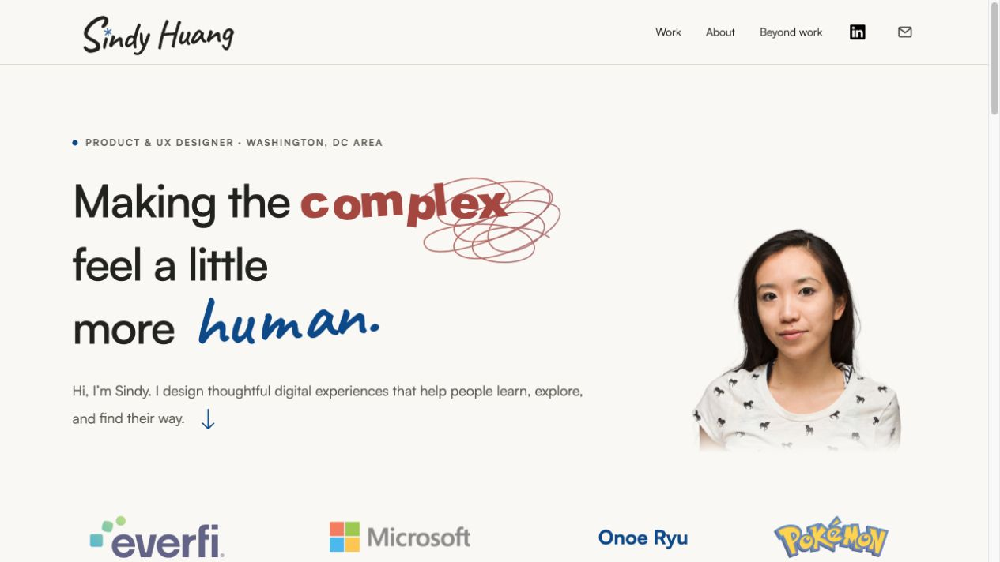
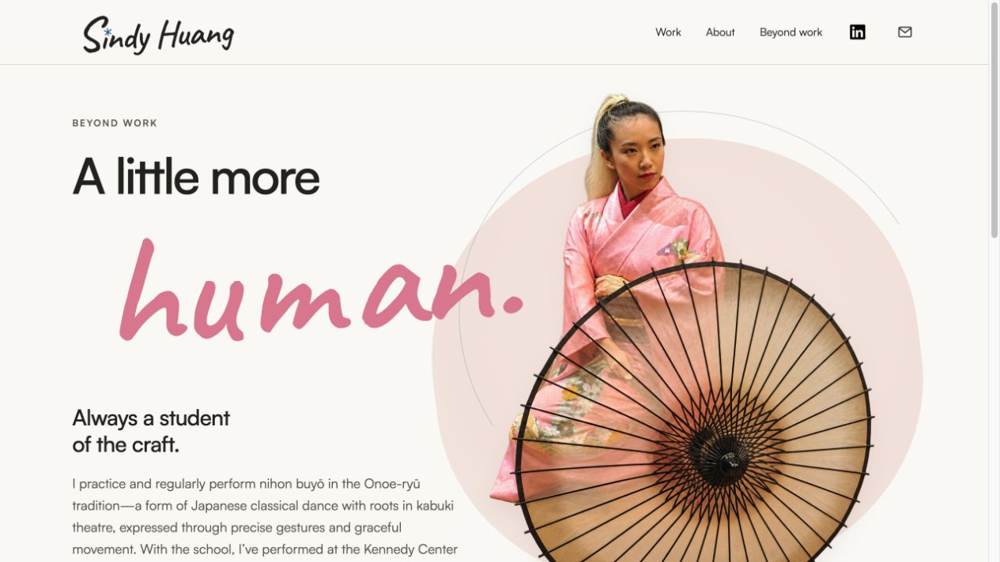

# Sindy Huang — Product & UX Design Portfolio

A responsive portfolio built with HTML, CSS, and JavaScript. No dependency installation or build step is required.

[View the website on GitHub Pages](https://stephenitis.github.io/sindy.ai/) · [View on ChatGPT Sites](https://sindyhuang.rlze.chatgpt.site/)

## Screenshots

### Homepage



### Beyond Work



## How this site was made

This portfolio grew through a hands-on collaboration with Sindy and her collaborators: gather existing work, shape the stories, build a working site, review it in the browser, and refine the details. The result is a lightweight static website with project case studies, a personal Beyond Work page, and supporting project resources.

### Where the material came from

- **Existing portfolio and project material:** Sindy’s previous website at [sindyhuang.com](https://www.sindyhuang.com/), résumé material, and Figma portfolio references informed the content and visual direction.
- **Direct contributions:** conversations, uploaded personal photos, a hand-drawn scribble reference, and annotated browser screenshots supplied biographical details and design feedback.
- **Public references:** [Onoe Dance](https://onoedance.com/performances-and-events/) and [Onoe-ryū](https://onoe-ryu.com/about_eg/) helped clarify the dance tradition and the school’s performance history. Public brand and product imagery sources are recorded in [asset-sources.json](asset-sources.json).
- **The working site:** local previews and published pages were inspected to check layout, navigation, image crops, and deployment results. GitHub became the primary source for the finished files.

These were reference inputs for building the portfolio, not a live data feed. Personal claims supplied by the collaborators and facts about an organization’s wider history were kept distinct.

### What AI contributed

OpenAI Codex assisted with research, writing and editing HTML/CSS/JavaScript, browser checks, troubleshooting, and publishing. Image-generation tools helped prepare photographic cutouts; SVG and CSS handled the signature, scribble, and typography. Some research and implementation work used delegated agents. Humans supplied the direction, reviewed the results, corrected mistaken assumptions, and chose what to publish.

### Challenges and lessons learned

- **Turning visual feedback into precise changes:** small requests about a star, a scribble, or line spacing often needed several previews. Annotated screenshots and changing one detail at a time made review clearer.
- **Keeping content accurate:** finding a relevant image did not establish that Sindy appeared in it. A proposed cosplay association was withdrawn after correction; uncertain personal details need confirmation.
- **Keeping versions aligned:** local drafts, GitHub Pages, and ChatGPT Sites could show different versions. Use one source repository and verify each deployment before calling a change live.
- **Managing AI context:** long chats, repeated browser inspections, and broad agent handoffs increased processing overhead. Keep decisions in project files, give workers narrow assignments, and request compact results. Cached input represents reused context, not newly written content or a direct billing total.
- **Making handoff simple:** plain static files, documented assets, screenshots, and local run instructions make the project easier to inspect and continue in another editor or AI coding tool.

The main lesson: AI accelerated iteration, but clear direction, source checks, and human visual review were essential to the final result.

## Run on Windows

1. Click **Code → Download ZIP** on this repository (or clone it with Git).
2. Right-click the downloaded ZIP and choose **Extract All**.
3. Open the extracted folder, then open **dist**.
4. Double-click **Start Website.cmd**. It uses Windows PowerShell to start a local server and opens your browser automatically.
5. Keep the command window open while browsing. Close it to stop the server.

The launcher tries ports **8765–8775**, listens only on your computer, and prints the local URL. It does not require Python, Node.js, or administrator access. If Windows blocks the launcher, use the Python option below rather than changing security settings. The bundled Windows launcher has not been tested on Windows in this development session.

### Alternative: Python on Windows

With Python 3 installed, open PowerShell in the repository folder and run:

```powershell
py -m http.server 8765 --bind 127.0.0.1 --directory dist
```

Open **http://127.0.0.1:8765/** in your browser. Press **Ctrl+C** in PowerShell to stop the server. If `py` is unavailable, try `python` instead.

### macOS / Linux

From the repository folder:

```sh
python3 -m http.server 8765 --bind 127.0.0.1 --directory dist
```

Open **http://127.0.0.1:8765/**. Press **Ctrl+C** to stop.

## Files

- `dist/index.html`: homepage
- `dist/beyond-work.html`: Beyond Work story
- `dist/style.css`: shared styles
- `dist/beyond-dance.css`: Beyond Work layout
- `dist/hero-yarn.js`: homepage scribble placement
- `dist/*.html`: project stories
- `dist/assets/`: images, logos, and fonts
- `docs/screenshots/`: README screenshots

## Deployment

GitHub is the primary source repository. The workflow in `.github/workflows/pages.yml` publishes `dist/` to GitHub Pages after pushes to `main`. The ChatGPT Sites deployment uses `.openai/hosting.json` and a separate publishing workflow.

Any static hosting service can serve `dist/`. No install or build is needed. External links require internet access; browser-stored features such as jobs-board progress remain specific to each browser and site address.

## Credits

Project contributions and biographical details are supplied by Sindy and her collaborators. Client marks and project imagery remain the property of their respective owners. Font licenses are included alongside the font assets.
